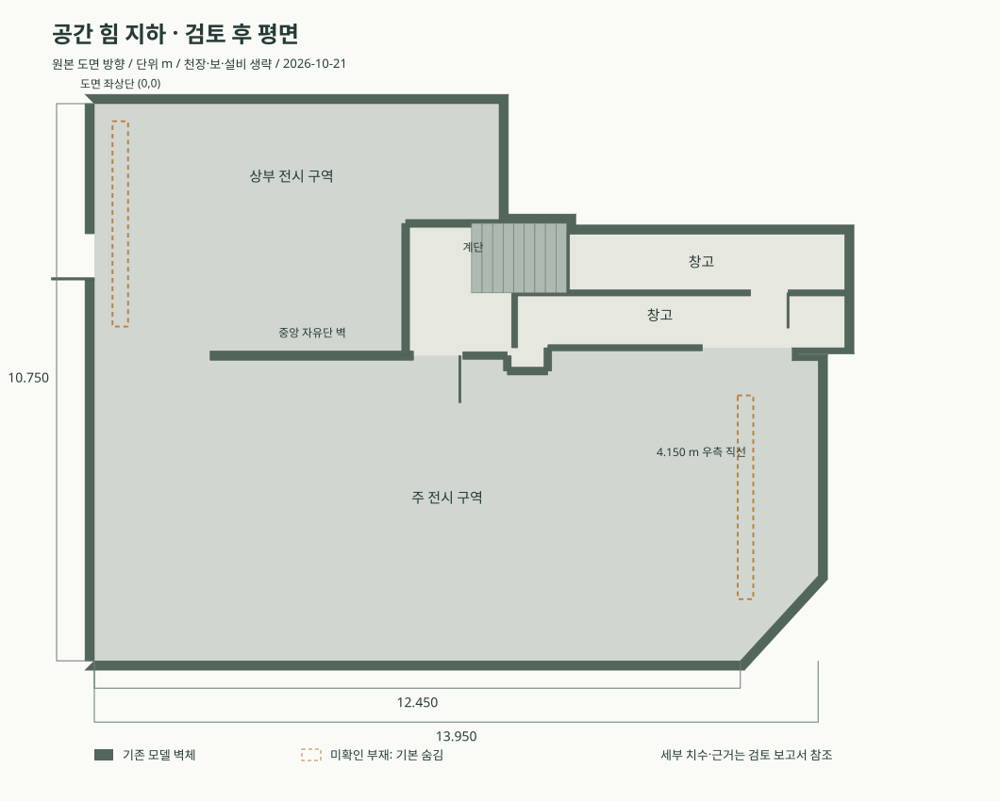

# 공간 힘 지하 모델 검토 · 2026-10-21

검토 자료는 사용자가 제공한 `공간 힘 지하 도면.jpg`, `공간 힘 지하.pdf`의 2·4~11쪽, `modeling/source/build_space_him.py`, 원본 OBJ와 모델 메모입니다. JPG와 PDF 2쪽의 간이 모델은 일부 부재 위치가 서로 다릅니다. 현재 웹 모델은 아래의 수정과 불확실성을 반영한 배치 검토용 모델입니다.

**외곽의 주요 치수는 확인했습니다. 내부 구획은 `7800` 치수와 도면 비례가 충돌하므로 실측 확인이 필요합니다.** 원본 모델은 가벽 위치를 도면 상단에서 약 4.86 m로 추정했습니다. `7800`을 하단에서 같은 구획까지의 깊이로 해석하면 상단에서 2.95 m가 되어 약 1.91 m 차이가 납니다. 두 표기가 같은 기준을 가리키는지 자료에서 확정할 수 없어 가벽을 임의로 옮기지 않았습니다.

## 확인 결과와 수정

| 항목 | 대조 결과 | 반영 |
|---|---|---|
| 외곽 | 13.950 m 폭, 10.750 m 전체 깊이, 12.450 m 하단 직선, 4.150 m 우측 직선이 모델과 일치 | 원본 형상 유지 |
| 도면 방향 | 이전 변환이 OBJ의 X만 반전해 도면 상하가 거울처럼 뒤집힘 | X와 Y를 함께 180° 회전하여 Blender `(u,-v,Z)` 좌표 복원. 평면 보기에서 원본 도면과 같은 방향 |
| 중앙 자유단 벽 | PDF 11쪽에서 확인됨. 평면 위치와 길이는 JPG 비례 추정 | 형상 유지. 실측 확정값으로 취급하지 않음 |
| 내부 구획 깊이 | `7800` 표기를 하단 구획 깊이로 읽으면 기존 비례 모델의 경계와 약 1.91 m 차이 | 도면의 치수 기점과 가벽 위치의 현장 확인 필요 |
| 길쭉한 직사각형 2개 | JPG에는 좌상·우하에 있음. PDF 2쪽은 상부 방의 반대쪽에 얇은 판을 표시하며 사진에서 같은 상태가 확정되지 않음. 2.30 m 높이의 근거 없음 | 원본 메시 보존, 기본 숨김. `도면 미확인 부재`로 별도 표시·배치 장애물 적용 |
| 노출 천장과 보 | 사진에 존재하지만 정확한 평면 위치, 단면, 보 하부 높이를 정할 구조 도면 없음 | 추정 모델 유지. 천장을 표시할 때만 보·천장 레일·배관 표시, 평면에서는 숨김 |
| 창고·계단 | 외곽과 꺾임은 JPG를 따름. 창고 상세 및 9단 × 180 mm 계단은 실측 근거 없음 | 원본 유지, 설치 가능 바닥에서 계단 제외 |
| 바닥·벽 재질 | Blender의 선형 RGB 값을 sRGB로 해석하여 바닥이 검정, 벽이 회색으로 과하게 어두워짐 | 선형 RGB → sRGB 변환으로 원본 재질값 복원 |
| 외벽 잘라 보기 | 불규칙한 외곽을 단순한 네 방향 기준으로 숨겨 일부 벽이 부자연스럽게 남음 | 각 외벽의 실제 위치와 바깥쪽 법선으로 잘라 보기 계산 |
| 출입구 평면 | 문 위 인방이 위에서 보이면서 평면의 출입구가 막힌 벽처럼 보임 | 평면 보기와 검토 평면에서 상부 인방 숨김 |
| 장비 기준점 | 기존 임시 기자재 메시가 중심 원점인데, 배치 코드는 바닥 원점으로 취급함 | 모든 기자재를 하단 Z=0 기준으로 통일. 바닥에 묻히거나 스탠드가 본체를 관통하는 현상 수정 |

원본 건축 부재 **167개, 삼각형 9,949개**는 좌표 변환 후 모두 보존됩니다. `data/spacehim-geometry-audit.json`에서 변환과 검사를 재확인할 수 있습니다. 미확인 부재 2개는 삭제하지 않았으며 기본 배치와 보행에서는 제외합니다. 옵션으로 표시하면 해당 부재와 겹치는 배치를 보정합니다.

## 아직 확인할 수 없는 항목

- 도면의 `7800` 표기는 전체 깊이 `10750` 및 그림 비례와 일관되지 않습니다. 전체 외곽과 다른 명시 치수를 우선한 기존 모델을 유지했습니다.
- `2440`, `250` 치수는 대응하는 보조선이 불명확해 강제 구속값으로 사용하지 않았습니다.
- `천고 2640`이 슬래브 아래인지 보 아래인지 자료만으로 확정할 수 없습니다. 현재 슬래브 하부 2.640 m, 주 보 하부 2.280 m를 가정합니다.
- 판 형태 부재의 실제 존재·높이, 보·배관의 정확한 배치, 계단 단수·방향, 창고 내부는 현장 확인이 필요합니다.

## QSC K8 수정

[공식 K Series 사양서](https://in.qscaudio.com/resource-files/productresources/spk/k/q_spk_k_specs.pdf)의 원래 **K8** 도면과 사용자가 지정한 World Mall 제품 사진을 참조했습니다. 외곽은 **폭 280 × 깊이 269 × 높이 450 mm**이며, 하단이 Z=0입니다. K8.2의 형상을 섞지 않았습니다.

단순 상자와 노출된 은색 드라이버 표현을 교체하여, 뒤로 좁아지는 ABS 캐비닛, 곡면 전면 타공 강판, 하단 배지, 상단 매립 손잡이, 후면 앰프 판넬·커넥터·팬·전원부, 바닥 35 mm 폴 소켓을 모델링했습니다. 곡률과 세부 위치는 사진 비례로 재구성했으며 제조사 CAD는 아닙니다.

편집 원본 및 교환 형식: `assets/equipment/qsc-k8/qsc-k8.blend`, `.obj` + `.mtl`, `.glb`. 뷰어는 같은 평가 메시를 `qsc-k8.json`에서 내장합니다. 검사할 때 장비 설정의 `장비 확대`를 사용할 수 있습니다.

이전 Space Him version 4 저장 파일과 브라우저 저장 배치는 version 5의 좌표에 맞춰 Y와 수평 방향을 자동 변환합니다. 다른 공간의 저장 형식은 유지합니다.
